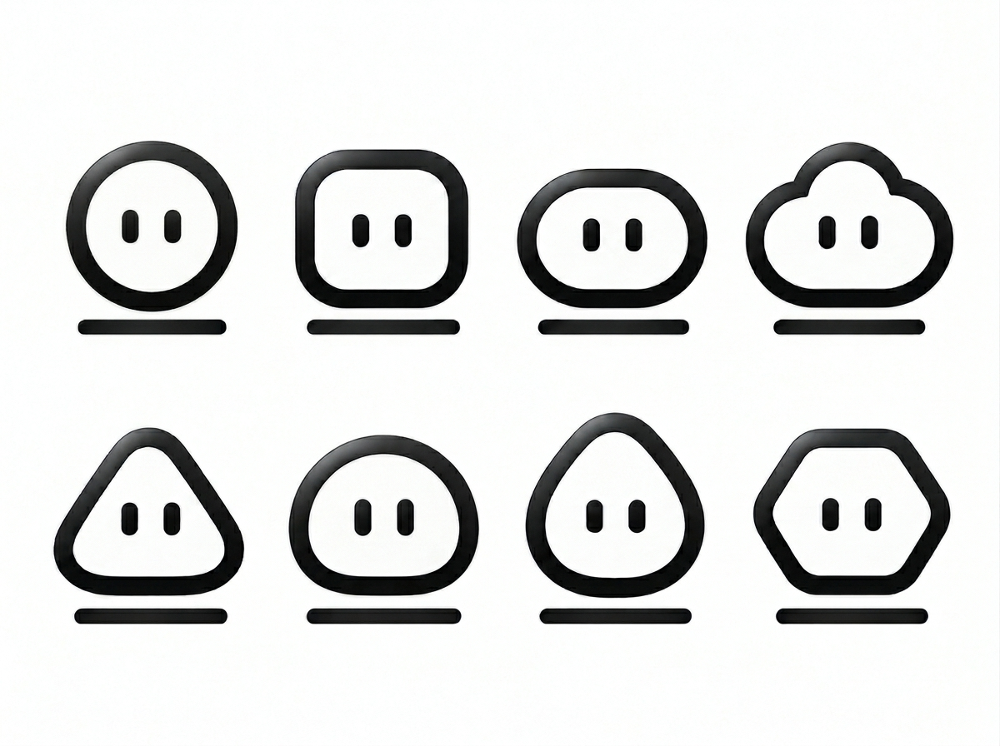

<h1 align="center">Hi, I'm Carry Chen 👋</h1>
<h3 align="center">AI-native builder · Backend engineer</h3>

  <a href="#what-ive-built">Featured project</a> ·
  <a href="https://github.com/carryclaw?tab=repositories">Repositories</a>

## About Me

I build backend systems and explore how AI agents can make everyday work simpler. I like turning small prototypes into tools people can use.

- **AI engineering** · LLM applications, agent workflows, and developer tools
- **Backend engineering** · Java services, system design, and reliability

  

## What I've Built

- **[Codex Permission Popup](https://github.com/carryclaw/codex-permission-popup)** · A native macOS dialog for reviewing Codex approval requests away from the terminal.

## Skills & Tools

`Java` · `Spring Boot` · `Python` · `TypeScript` · `MySQL` · `Redis` · `Docker`
